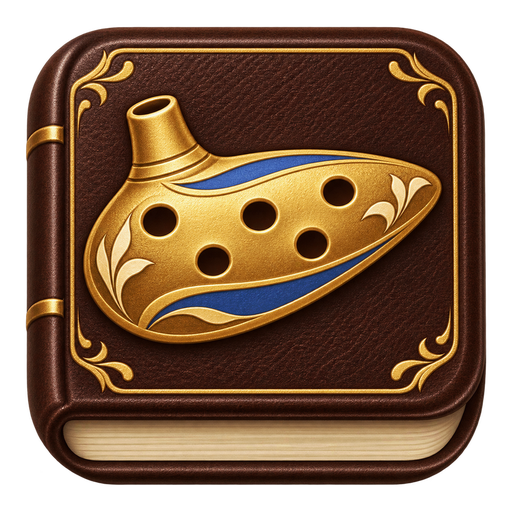
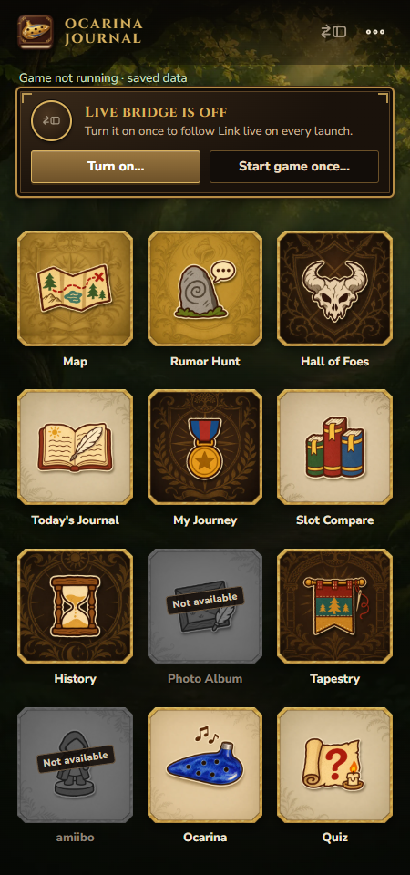
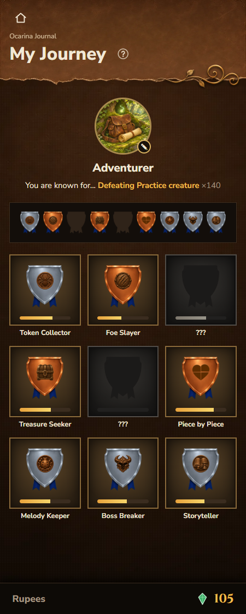
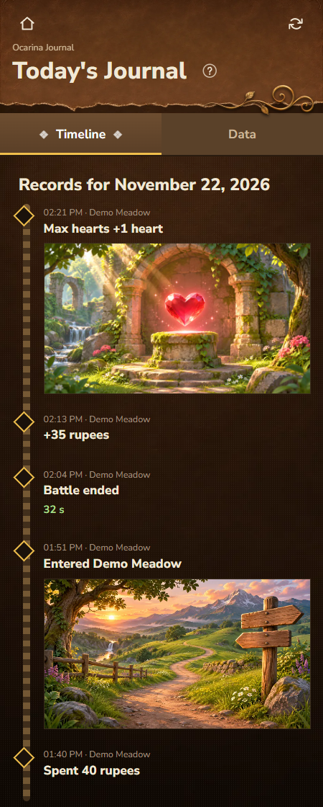
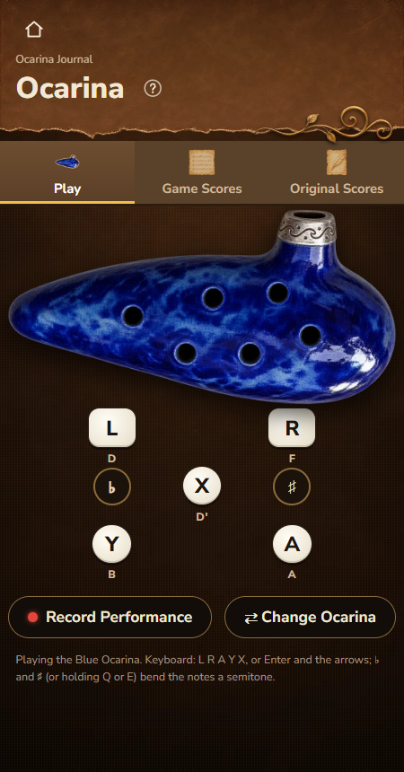

<p align="center"></p>

# Ocarina Journal

[](https://github.com/KeyErrorFinn/ocarina-journal/actions/workflows/ci.yml)
[](LICENSE)
[](https://github.com/KeyErrorFinn/ocarina-journal/releases)
[](https://github.com/KeyErrorFinn/ocarina-journal/releases)
[](https://github.com/KeyErrorFinn/ocarina-journal/graphs/contributors)

[Contributing](CONTRIBUTING.md) · [Common contribution guides](docs/workflows/README.md) ·
[Discussions](https://github.com/KeyErrorFinn/ocarina-journal/discussions)

An unofficial, read-only **companion app for Windows and Linux** for the native PC recompilation of
*The Legend of Zelda: Ocarina of Time* ([Longshot](https://github.com/Recomper/Longshot)). It is a fan-made
take on the idea behind Nintendo's *Zelda Notes*: a pocket journal that shows what you have found, what you
have missed, and how your day of play went. It runs on your own PC, from your own saves and your own game files.

> **Not affiliated with, endorsed by, or connected to Nintendo or the Longshot project.**
> Ocarina Journal contains no game files, keys, Nintendo assets or Nintendo source code. All artwork in the
> app is original. "Zelda", "Ocarina of Time" and related names belong to Nintendo.

**Status: 1.1.1.** The Windows app (first released as 1.0.0) runs and reads real saves. The Linux build is new in
1.1.0: CI builds it and starts it in a virtual display, but it hasn't yet been run against a live Linux Longshot
game, so treat Linux as an early release (see [`docs/research/LINUX.md`](docs/research/LINUX.md)). Expect rough
edges, and see [Known gaps](#known-gaps) for what is still unverified.

## Screenshots

These are captures of the app's frontend in a browser, without native window chrome. Home and Ocarina show
no-game states; My Journey and Today's Journal use invented demonstration data, including the place
"Demo Meadow". They contain no player's saves, game-derived maps or text, or personal information.

<p>
  <a href="assets/screenshots/home.png"></a>
  <a href="assets/screenshots/journey.png"></a>
  <a href="assets/screenshots/journal.png"></a>
  <a href="assets/screenshots/ocarina.png"></a>
</p>

## What it does

The app has a freely resizable window with twelve tiles. The whole app shrinks with the window (down to about 160 px
wide) and stays complete. In the Home menu's **Window** section you can keep it on top of other windows, make it
see-through (with a slider for how solid it is) to overlay it on a game, and hide the title bar:

| Tile | What it shows |
|---|---|
| **Map** | The game's own world, area and dungeon-floor maps (read from your game folder), with the chests, Gold Skulltulas and hearts you have and haven't found, exits, floors, and Link live |
| **Rumor Hunt** | Rumours about landmarks in your own game (gossip stones, grottos, cows, frogs and more): go there with the bridge on and tap Found! for points, then spend them on ocarinas |
| **Hall of Foes** | Enemies and bosses defeated, kill counts, Hall rematch records and the three trials, locked until the save opens the Hall |
| **Today's Journal** | What each save gained today (works without the bridge, even with the app closed), plus a live timeline and stats with the bridge on |
| **My Journey** | Medals up to Master, your picture, and what you are known for |
| **Slot Compare** | Your save slots side by side |
| **History** | Past days and what their saves gained, kept on your PC (a day runs 05:00 to 04:59) |
| **Tapestry** | The game's own Threads of Time tapestry (read from your game folder), each section woven, in silhouette or empty to match your save's quests |
| **Photo Album** | Shown as unavailable: the PC version has no photo capture for it to use |
| **Ocarina** | Plays the game's own ocarina sounds (read from your game files) with the remake's buttons, ♭/♯ bends, songs on a staff with Guided Play and the game's own recordings, and your scores shared as QR cards |
| **Quiz** | Egg (20) and Cucco (30) levels and the Cojiro Challenge; most questions are made from your game's own item and enemy descriptions and world map |
| **amiibo** | Shown as unavailable: a PC has no NFC reader |

It has three modes:

- **Live** – the game is running with Longshot's control bridge on; data updates as you play.
- **Bridge off** – the game is running without the bridge. Saved data still works, and the app can offer to
  turn the bridge on (after showing you exactly what it would change and asking first).
- **Offline** – the game isn't running. The app reads your save files.

The names, categories, totals, map pictures and tapestry come from your own installed game files and saves, read by the app
itself on your PC (see `docs/research/GAME_MAPS.md`). Nothing from the game is in this repository, and nothing is
uploaded anywhere.

## Safety and privacy

- **Read-only by default.** The bridge client only sends the read-only `status` and `subscribe` requests. The
  protocol type in `oj-protocol` has no write commands.
- **Your saves are never modified.** Save files are only read.
- **Local only.** The bridge is a same-user Windows named pipe, or a same-user Unix socket on Linux, never a network
  port. The app does not open any listening socket. Its only network call is the update check: one plain HTTPS request to
  GitHub for the newest release, sent only when you press "Check for updates" or leave the start-up check on
  (it starts on, and one switch in the menu turns it off). A newer version only brings up a question; "yes" opens its
  GitHub page. Nothing is downloaded or installed for you.
- **Explicit consent for changes.** The actions that change anything (on Windows, adding `HOS_CONTROL` to
  `longshot_env.txt`; on both, starting Longshot with the bridge on) show what will happen and need a button press.
  The first makes a backup copy of the file before writing. On Linux the app doesn't edit any Longshot file.
- **No circumvention.** The project does not touch Nintendo's servers, accounts, tokens or app protections.

## Requirements

- Windows 10/11 (x64), or a 64-bit (x86_64) Linux desktop with WebKitGTK 4.1
- A working Longshot install with its own game files (you supply these; this project doesn't and can't)
- To build: [Rust](https://rustup.rs) (stable), [Node.js](https://nodejs.org) 20+, [pnpm](https://pnpm.io), and the
  [Tauri 2 prerequisites](https://tauri.app/start/prerequisites/) for your system (Windows: WebView2 and the MSVC
  build tools; Linux: WebKitGTK and GTK development packages, see [Linux](#linux))

Installers are published under [Releases](https://github.com/KeyErrorFinn/ocarina-journal/releases), unsigned.
Your game files and saves are supplied separately and are never bundled. Downloads are manual; the app does not
check for updates or contact a server. You can also build from source below.

### Windows

The Windows x64 installer installs for the current Windows user and requires WebView2. To update, close Ocarina
Journal and run the new `-setup.exe`. It updates the existing installation in the same folder, preserves your
settings and journal data, and keeps one entry in Windows Installed apps. You do not need to uninstall first.
Running the same version repairs it. New installers reject downgrades.

### Linux

Releases include a `.deb`, an `.rpm` and an AppImage for x86_64, all unsigned. They are built on Ubuntu 22.04, so
the glibc they need is that old or older. The app uses the system's WebKitGTK 4.1 (`libwebkit2gtk-4.1`) and GTK 3.

- **AppImage:** `chmod +x Ocarina.Journal_*.AppImage`, then run it. It uses your system's graphics libraries
  (EGL, from Mesa or your GPU driver), which any desktop install has.
- **Debian, Ubuntu:** `sudo apt install ./Ocarina.Journal_*.deb`
- **Fedora, openSUSE:** `sudo dnf install ./Ocarina.Journal-*.rpm`

All three were installed and started on clean Ubuntu 22.04 and 24.04 and Fedora machines before release (see
[the 1.1.0 validation](docs/releases/1.1.0-validation.md)). They expect an ordinary desktop session, including a
D-Bus session bus.

Where it looks, on Linux, for what it reads (verified against Longshot's own documentation; details and what is
still unverified are in [`docs/research/LINUX.md`](docs/research/LINUX.md)):

| What | Where |
|---|---|
| The game | `~/Games/Longshot`, directly or inside a channel folder such as `stable/` (or the folder of a running `longshot`; `OJ_GAME` overrides) |
| Your saves | `~/.local/share/longshot`, from `save` or `save-work`, whichever changed last (`OJ_SAVE_DIR` selects one user folder) |
| This app's own data (journal, save log) | `~/.local/share/ocarina-journal` (private, mode 0700) |

For live mode, use **Start game** on the Home screen: it starts `bin/longshot` with the bridge on at a private Unix
socket inside this app's data folder, for that launch only. The persistent "turn the bridge on" switch is Windows
only. To start Longshot yourself with the bridge on, set `HOS_CONTROL` to the same socket path
(`OJ_PIPE` changes the path; it must be absolute and short, in a folder only you can write to).

## Build and run

```powershell
git clone https://github.com/KeyErrorFinn/ocarina-journal.git
cd ocarina-journal

cd app
pnpm install
pnpm tauri dev        # development window with hot reload
pnpm tauri build      # installer or packages under target/release/bundle (workspace target directory)
```

On Linux, first install the build prerequisites. On Debian or Ubuntu:

```sh
sudo apt install libwebkit2gtk-4.1-dev libgtk-3-dev librsvg2-dev libayatana-appindicator3-dev patchelf build-essential
```

(Other distributions: see the [Tauri prerequisites](https://tauri.app/start/prerequisites/#linux).) `pnpm tauri build`
then produces the `.deb`, `.rpm` and AppImage; the Windows build produces the NSIS installer.

To use Live mode, start Longshot with the bridge on. The app can do this for you from its Home screen. On Windows
you can also set `HOS_CONTROL=longshot` in the environment or in `longshot_env.txt` yourself. The app looks for the
game in the usual Longshot folders and also picks up the folder of a running Longshot process.

## Repository layout

```
app/                  Tauri 2 desktop app (React + TypeScript + Vite) and its Rust backend (app/src-tauri)
crates/oj-protocol    Bridge request/response types (read-only commands only)
crates/oj-bridge      Bridge client with reconnect (Windows named pipe, Linux Unix socket)
crates/oj-journal     Turns live samples into a timeline and daily totals
crates/oj-savefile    Reader for the game's save files (progress.sav flag table)
crates/oj-gamedata    Reads names, categories and maps from your game files (zstd, SARC, BYML, MSBT, BNTX)
crates/oj-testkit     Fake bridge and synthetic fixtures for tests
docs/research/        Investigation notes, formats, architecture, risks and open questions
docs/workflows/       Step-by-step guides for common contributions
```

Run the tests with:

```powershell
cargo test --workspace
```

The game-data integration tests skip silently unless you set `OJ_TEST_GAME` to your own install's folder
holding `romfs`. The golden comparison also needs `OJ_TEST_SAVE` and `OJ_TEST_GOLDEN`. Other live tests use
`OJ_TEST_REAL=1`; see [Contributing](CONTRIBUTING.md#tests-that-need-the-game) and each test's header.

## Known gaps

Honesty about what hasn't been confirmed is part of this project. Open items:

- **Hall record times**: the unit of the saved best time is assumed to be 60 frames per second. No save with a
  recorded rematch has been checked yet.
- **Map details**: the Water Temple's water level and dungeon room states aren't read yet; the map shows the first
  of each (see `docs/research/GAME_MAPS.md`).
- **Tapestry states**: when the game shows a section as a silhouette rather than empty is our reading (once its
  quest has started), and the bottom band is assumed to appear when Ganon is defeated. Neither has been checked
  against the game (see `docs/research/GAME_MAPS.md`).
- **Daily stat counters** (grass cut, jumps, and similar): no matching save flags were found, so Today's
  Journal doesn't show them.
- **Launcher behaviour**: starting Longshot's binary directly needs `--user <your Longshot data folder>` to use your
  real saves. Whether the official Launcher does the same hasn't been confirmed.
- **Linux**: the Linux app has been built and started in a virtual display by CI, and its bridge client is tested
  against a real Unix socket, but it hasn't been run against a live Linux Longshot game. Wayland behaviour and
  distributions other than Ubuntu are untested. Whether Longshot reads an environment file on Linux (so the app
  could offer a persistent bridge switch there) isn't established.
- **Screenshots in the timeline**: not available; capturing the game would need a write-capable command
  with its own consent step.
- **Online features**: global comparison, leaderboards and amiibo depend on Nintendo's services or the console
  and are not possible here.

See `docs/research/RISKS_AND_LIMITATIONS.md` and `docs/research/IN_APP_NAME_READER.md` for the details.

## Help wanted

Start with [good first issues](https://github.com/KeyErrorFinn/ocarina-journal/labels/good%20first%20issue),
[help wanted](https://github.com/KeyErrorFinn/ocarina-journal/labels/help%20wanted), or
[research findings](https://github.com/KeyErrorFinn/ocarina-journal/labels/research). Questions and ideas go in
[Discussions](https://github.com/KeyErrorFinn/ocarina-journal/discussions).

If you own the real *Zelda Notes* in the Nintendo Switch app and are willing to help, the most useful things
are the ones nobody can derive from the game files:

- Tell us how the **daily stats** and **medal tiers** behave (what counts, and at which numbers a tier changes).
- Confirm the **Hall of Fallen Foes** record display (the time format of rematch records).
- Share **your own descriptions or notes** of screens, wording and flow. Please do **not** send Nintendo's
  artwork, screenshots of copyrighted art, or anything that would require bypassing the app's protections;
  we can't use those.

Players of the PC recompilation can also help by running the app against their saves and reporting what looks
wrong. Open an issue and say which game revision and Longshot version you used.

## Contributing

Small fixes, original art and documented research are welcome. Read [CONTRIBUTING.md](CONTRIBUTING.md), the
[project rules](docs/RULES.md) and [do's and don'ts](docs/DOS-AND-DONTS.md) before starting. The
[workflow guides](docs/workflows/README.md) cover quiz questions, medals, save flags, map kinds, landmarks and
screen fixes. For larger features, redesigns or platform ports, open an issue to agree on scope before
building them, then contribute through focused pull requests.

Maintainers: [repository activation and release checklist](.github/maintainer/SETUP.md) and
[review policy](.github/maintainer/MAINTAINER.md).

## Contributors

Thank you to everyone who has contributed to Ocarina Journal.

[](https://github.com/KeyErrorFinn/ocarina-journal/graphs/contributors)

The pictures above and the badges at the top (total release downloads, contributor count) update by themselves
and are drawn by third-party services ([contrib.rocks](https://contrib.rocks), [shields.io](https://shields.io)),
so viewing this page contacts them; the app itself never does. The download count includes every file attached to
a release (installers, packages, checksums and source archives). Descriptions, research and testing count as
contributions too; if you helped without a commit, open an issue or discussion and we'll credit you in the changelog.

## Legal

This is an unofficial fan project. It is not licensed by Nintendo. The code is declared **GPL-3.0-or-later**
in the Cargo manifests. The save catalogue rules are conservatively treated as adapted GPL work from the
Longshot save-editor contributions, with attribution and source supplied under the same licence. See
[third-party notices](THIRD_PARTY_NOTICES.md) and the [provenance review](docs/research/LICENSING_PROVENANCE.md).
Nothing here is legal advice.

Created in [T3 Code](https://t3.codes).
